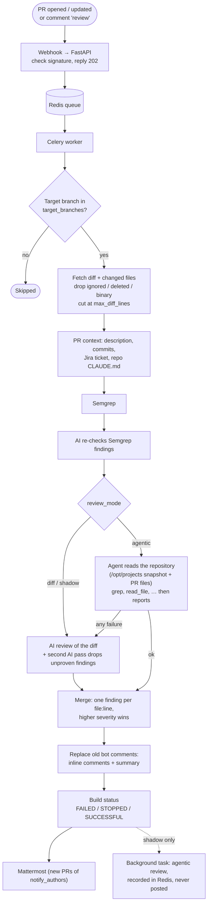

# Code Review Bot

Reviews every pull request automatically: Semgrep static analysis plus an AI review (Claude or GLM). Findings are posted as inline comments and a summary, and the build status can block the merge.

Works with Bitbucket Cloud (main platform), GitHub and GitLab. Languages: Java, JS/TS, C#, PHP, Python.

## How it works



In short: the worker prepares the diff and the PR's context, runs Semgrep and the AI review (each finding double-checked by the AI), merges the results and posts them.

| Severity | Meaning | Posted as |
|----------|---------|-----------|
| `CRITICAL` | Exploitable security hole, data loss | inline + summary; blocks merge by default |
| `BUG` | Incorrect behavior with a concrete scenario | inline + summary |
| `PERFORMANCE` | Real cost on a realistic path (N+1, blocking I/O) | inline + summary |
| `SUGGEST` | Removes a concrete future risk | summary only |

Build status: `FAILED` if a finding matches `block_merge_on`, `STOPPED` if the AI reviewed nothing (budget or API failure), otherwise `SUCCESSFUL`.

**Re-run a review:** push a commit, or comment `review` on the PR. Old bot comments are replaced.

**Review modes** (per repo, see [Review modes](#review-modes)): `diff` — the AI sees the diff and changed files; `agentic` — the AI also reads the repository with tools; `shadow` — `diff` is posted, `agentic` runs in the background for comparison.

## Setup

Requirements: a Linux server with Docker + Compose plugin, a domain with HTTPS (Nginx + Let's Encrypt), 2+ vCPU, 4+ GB RAM.

### 1. Get the code and configure

```bash
git clone <repo-url> /opt/code-review && cd /opt/code-review
cp .env.example .env                                     # AI keys, budget, optional Jira/Mattermost
cp config/credentials.yml.example config/credentials.yml # platform tokens + webhook secrets
cp config/projects.yml.example config/projects.yml       # which repos to review, and how
chmod 600 .env config/credentials.yml
```

`.env`, `config/credentials.yml` and `config/projects.yml` are git-ignored: each instance keeps its own. Back them up.

**`.env`** — main variables (full list with defaults: `app/config/settings.py`):

| Variable | Default | Purpose |
|----------|---------|---------|
| `AI_PROVIDER` | `claude` | `claude` or `glm` |
| `ANTHROPIC_API_KEY`, `AI_MODEL` | —, `claude-sonnet-5-5` | Claude |
| `ZAI_API_KEY`, `GLM_MODEL` | —, `glm-5-turbo` | GLM (Z.AI) |
| `AI_DAILY_TOKEN_BUDGET` | `10000000` | Input+output tokens per day; `0` = unlimited. When reached, reviews get `STOPPED` |
| `AI_MAX_DIFF_TOKENS` | `60000` | Diff per AI request; bigger diffs are split by whole files |
| `AI_MAX_TOKENS` | `16000` | Max AI answer (incl. thinking) |
| `AI_FILE_CONTEXT_MAX_CHARS` | `120000` | Full changed files sent with the diff; `0` disables |
| `AI_PR_CONTEXT_MAX_CHARS` | `40000` | PR description + commits + Jira ticket + repo guide; `0` disables |
| `JIRA_BASE_URL`, `JIRA_EMAIL`, `JIRA_API_TOKEN` | empty | Optional. Ticket key is taken from the branch name or PR title. Use a read-only account or a token with the `read:jira-work` scope |
| `MATTERMOST_WEBHOOK_URL` | empty | Optional. Message on new PRs by authors listed in `notify_authors` |
| `REDIS_PASSWORD` | — | Set your own |

Agentic review settings are in [Review modes](#review-modes).

**`config/credentials.yml`** — per workspace or per repo: an API token (Bitbucket: repository or workspace access token with **Repositories: Read**, **Pull requests: Read, Write**) and a `webhook_secret` (`openssl rand -hex 32`). The example file shows every option, including GitHub and GitLab.

### 2. Start

```bash
docker compose up -d --build
docker compose ps                      # app, worker, redis, prometheus, grafana — all Up
curl http://localhost:8000/health      # {"status":"ok","redis":"ok"}
```

### 3. Expose over HTTPS

Nginx site proxying to the app:

```nginx
server {
    server_name review.example.com;
    location / {
        proxy_pass http://127.0.0.1:8000;
        proxy_set_header Host $host;
        proxy_set_header X-Forwarded-For $proxy_add_x_forwarded_for;
        proxy_set_header X-Forwarded-Proto $scheme;
        client_max_body_size 10M;
    }
}
```

```bash
nginx -t && systemctl reload nginx
certbot --nginx -d review.example.com
ufw allow OpenSSH && ufw allow 'Nginx Full' && ufw deny 8000 && ufw enable
```

Redis and Prometheus listen on localhost only. Grafana (`:3000`) is public and starts with `admin`/`admin` — change the password, or put it behind Nginx and close the port.

### 4. Add a repository

1. Add it to `config/projects.yml` (see [Configuring projects](#configuring-projects)).
2. Add its token/secret to `config/credentials.yml` if the workspace isn't there yet.
3. Add a webhook in the repo:
   - **Bitbucket:** Repository settings → Webhooks → Add. URL `https://<domain>/webhook/bitbucket`, secret = `webhook_secret`, triggers: Pull request **Created**, **Updated**, **Comment created**.
   - **GitHub:** URL `/webhook/github`, content type JSON, secret = `webhook_secret`, events: Pull requests, Issue comments.
   - **GitLab:** URL `/webhook/gitlab`, secret token = `webhook_secret`, trigger: Merge request events.
4. Open a test PR and watch `docker compose logs -f worker`.

No restart needed — `projects.yml` and `credentials.yml` are read on every review.

## Configuring projects

Settings are resolved per PR: defaults → `config/projects.yml` (on the server) → `.codereview.yml` in the repo root (read from the target branch, overrides the central file).

```yaml
projects:
  myworkspace/my-service:          # repo full name: workspace/slug
    language: java
    target_branches: [master, demo-dev]
    max_diff_lines: 5000
    ignore_paths: ["**/*.properties", "src/generated/**"]
    ai_focus: [bugs, billing rules]
```

| Field | Default | Description |
|-------|---------|-------------|
| `language` | `auto` | `java`, `dotnet`, `php`, `js`, `python`, `auto` (by file extensions). Selects the prompt and Semgrep rules |
| `target_branches` | `[master, main]` | Only PRs into these branches are reviewed |
| `ai_review` | `true` | Run the AI review |
| `ai_verify` | `true` | Second AI pass that drops unproven AI findings |
| `ai_focus` | `[security, bugs]` | `security`, `bugs`, `performance` or free text |
| `ai_context_files` | `[CLAUDE.md]` | Repo files sent to the AI as the project's conventions |
| `static_analysis` | `true` | Run Semgrep |
| `semgrep_rules` | `[owasp, security-audit]` | e.g. `p/java`, `p/csharp`, `p/php`, `p/javascript`, `p/python`, `p/django`, `p/secrets` |
| `semgrep_ai_verify` | `true` | AI re-checks Semgrep findings |
| `block_merge_on` | `[CRITICAL]` | Severities that set the build status to `FAILED`; `[]` never blocks |
| `max_diff_lines` | `500` | Larger diffs are cut at file/hunk boundaries; skipped files are listed in the summary |
| `ignore_paths` | `[]` | Globs excluded from review |
| `notify_authors` | `[]` | PR authors (display names) whose new PRs trigger a Mattermost message |
| `review_mode` | `diff` | `diff`, `agentic`, `shadow` — **central file only** |
| `agent_max_steps` | `20` | Agentic: code lookups per review — **central file only** |
| `context_repos` | `[]` | Agentic: other repos the agent may search — **central file only** |

`config/projects.yml.example` has ready-made blocks for each language.

**Better results:** put a `CLAUDE.md` in the repo describing its architecture and conventions; name branches with the Jira key (`feature/BP-123-...`); write a PR description. All of it goes to the AI as context.

## Review modes

```yaml
  myworkspace/my-backend:
    review_mode: agentic            # diff | agentic | shadow
    context_repos: [myworkspace/shared-core]
```

| Mode | Posted to the PR | Cost |
|------|------------------|------|
| `diff` | Standard review | 1× |
| `agentic` | Review by an AI that reads the repository (`read_file`, `grep`, `find_files`, `list_dir`) before reporting. **On any failure the standard review runs instead**, with a note in the summary | several × |
| `shadow` | Standard review; the agentic one runs afterwards and is only recorded | 1× + agentic |

Start with `shadow`, compare, then switch to `agentic`:

```bash
docker compose exec worker python scripts/shadow_report.py --details
```

**Where the agent reads code from** — nothing is cloned for it, and the PR branch is never checked out:

- `/opt/projects/<repo-slug>` on the server — shallow clones of each repo's main branch, updated by a separate cron. Mounted **read-only**; the bot never changes it. **A repo that isn't there is not reviewed agentically.**
- Files changed in the PR are taken from the PR's head commit through the platform API and laid over that snapshot; files the PR deletes are hidden.
- PRs into another branch (`demo-dev`, …) use the bot's own depth-1 clone of that branch (Docker volume `branch_snapshots`, re-cloned every 6 hours, no history kept). Create big ones in advance — otherwise the first review clones inside its time budget, may fall back, and won't retry for an hour:

  ```bash
  docker compose exec worker python -m app.context.snapshots bitbucket myworkspace/my-backend demo-dev
  ```

Limits: `agent_max_steps`, `AGENT_MAX_TOKENS_PER_REVIEW` (800k), `AGENT_MAX_DIFF_TOKENS` (30k; diffs over 3× fall back), 600 s of extra task time — the regular time stays reserved for the fallback. Other settings: `PROJECTS_SNAPSHOT_DIR` (`/projects`), `BRANCH_SNAPSHOT_DIR` (`/repos`), `BRANCH_SNAPSHOT_MAX_AGE_HOURS` (6).

## Operations

```bash
git pull && docker compose up -d --build app worker   # update
docker compose restart app worker                     # apply .env changes
docker compose logs -f worker                         # follow reviews
docker compose logs worker | grep -E "Done —|failed|fell back|Shadow review"
```

**Monitoring.** Prometheus scrapes `/metrics`; Grafana (`:3000`) has dashboards for reviews, findings, AI cost and reliability (`grafana/dashboards/`). Notable metrics: `code_review_ai_verify_total`, `code_review_agentic_total{result="ok|fallback|shadow_ok|shadow_failed"}`, daily token usage vs. budget.

**Redis** holds the queue and all metrics. It runs with AOF + RDB snapshots on the `redis_data` volume and restores the latest backup if the volume is empty.

```bash
./scripts/setup-redis-persistence.sh               # one-time setup
./scripts/redis-backup.sh                          # backup to backups/redis/ (cron it, or use the systemd timer
                                                   #   scripts/redis-auto-backup.{service,timer})
./scripts/redis-restore.sh backups/redis/<file>.rdb
```

`docker compose down -v` deletes all metrics.

## Troubleshooting

| Symptom | Check |
|---------|-------|
| Webhook `400` "No credentials" | The workspace/repo is missing in `config/credentials.yml` |
| Webhook `401` | `webhook_secret` differs from the secret in the platform's webhook |
| `202` but no review | `docker compose ps worker`, `docker compose logs --tail=100 worker` |
| PR is ignored | Target branch not in `target_branches`; repo key in `projects.yml` must be `workspace/slug` |
| Build status `STOPPED` | Daily token budget reached or AI API failing — the summary says which |
| Worker restarts on start | `docker compose logs worker` — usually a dependency or `.env` error |
| Summary says "Deep review unavailable" | Agentic failed and the standard review ran; the reason is in the note (e.g. repo not in `/opt/projects`) |
| No Jira context | `JIRA_*` unset, no ticket key in branch/title, or `Failed to fetch Jira ticket` in the logs |

## Development

```bash
pip install -r requirements.txt
pytest tests/ -m "not integration"     # unit tests; integration ones need semgrep installed
uvicorn app.main:app --reload          # API
celery -A app.workers.celery_app worker --loglevel=info
```

```
app/
├── main.py              webhooks, /health, /metrics
├── models.py            Finding, PRContext, ReviewConfig
├── metrics.py           Redis counters → Prometheus
├── adapters/            Bitbucket, GitHub, GitLab (GitPlatform in base.py)
├── analyzers/           semgrep_runner, ai_reviewer (diff mode), agent_reviewer (agentic), merger
├── context/             PR context + Jira, code snapshots, agent tools
├── config/              settings (.env), project_config (projects.yml + .codereview.yml)
├── notifiers/           Mattermost
├── utils/diff_parser.py ignore / truncate the diff
└── workers/celery_app.py  the review pipeline, shadow task
prompts/                 review_base.md + <language>_prompt.md, verify_*.md, agent_review.md
```

Prompts are read on every review — edit them without a restart.

**New language:** add `prompts/<language>_prompt.md` (language pitfalls only; rules and JSON schema are in `review_base.md`), map extensions in `_EXT_TO_LANG` (`app/config/project_config.py`) and Semgrep rules in `SEMGREP_RULE_MAP` (`app/analyzers/semgrep_runner.py`).

**New platform:** implement `GitPlatform` (`app/adapters/base.py`), register it in `app/adapters/factory.py`, add a `/webhook/<platform>` route in `app/main.py`, add tests.

Design decisions and their reasons are in [CLAUDE.md](CLAUDE.md).
